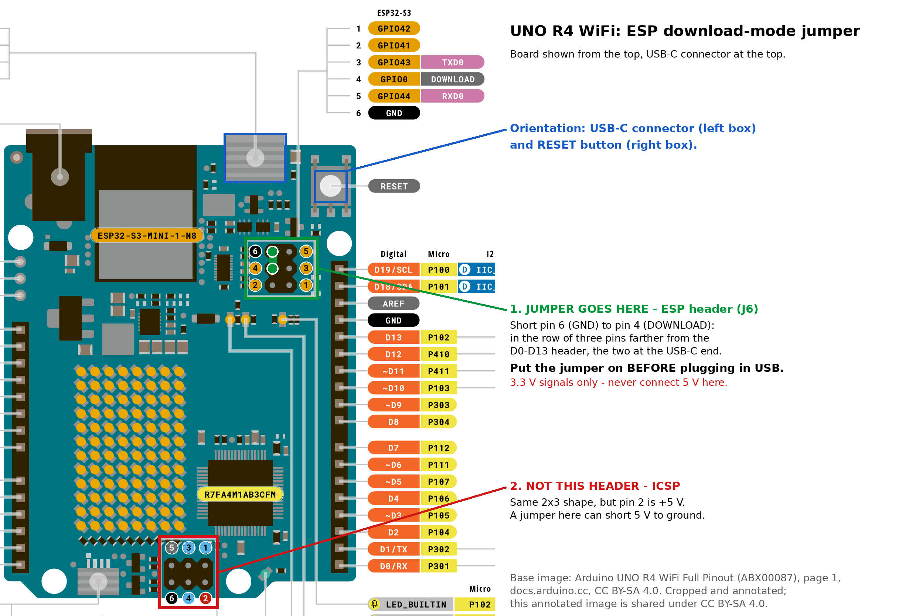

# UNO R4 WiFi interrupt bridge 0.6.101 — flash and test procedure

This procedure flashes the **interrupt fork** of the bridge firmware to
an Arduino UNO R4 WiFi, then proves push mode works with the example
sketch in `examples/UDPPushSleep`: the board's RA4M1 sleeps until a UDP
datagram sent from the PC arrives, without ever asking for it. It
contains only what you do and what you should see.

> [!IMPORTANT]
> This procedure assumes two things:
>
> 1. You have followed
>    [build-original-procedure.md](build-original-procedure.md) to the
>    end on this computer and this board. It reuses that procedure's
>    serial-port access, espflash, esptool and jumper method, and does
>    not repeat their setup.
> 2. You have followed
>    [build-interrupt-procedure.md](build-interrupt-procedure.md), so
>    the image `~/unor4wifi-images/UNOR4-WIFI-S3-0.6.0-interrupt.1.bin`
>    exists.
>
> Step P below checks both.

> [!CAUTION]
> Step 4 writes to the board. Do not start step 1 until step P has
> passed every ✅ check.

**Run on a board on 2026-10-22.** This procedure was followed end to
end on a UNO R4 WiFi running the stock firmware, with the image that
build-interrupt-procedure.md produced (the same file, byte for byte,
in two separate builds). Step 3 was skipped, as 3.1 allows. The ✅
lines in 2.3, 4.2.2, 5.2, 5.4 and 5.5 quote what was seen. The port
capture in 2.3 was added after that run and checked on the board
separately: it found the port in download mode, and the chip check in
3.2 ran through it.

## How to use this procedure

- Do the actions in order. Each one has a number (`1.1`, `1.2`, …).
- Each step starts with a **status line**: whether the board is
  plugged in, whether the jumper is on, and where to run commands.
- Each action shows what to run, then:
  - ✅ — what you must see. If you see it, go to the next action.
  - ❌ — what to do if you see something else. Usually "→ **Fix 1.1**
    below": the fix is in its own box directly underneath, inside the
    same action. It ends with **Then:**, which tells you what to do
    next. If you got a ✅, skip the fix boxes.
  - **Expected noise** — warnings you will see that are normal.
- If a result matches neither the ✅ nor any ❌: **stop.** Do not
  improvise, especially in steps 2–4.
- If you stop after step 2 has put the board in download mode, take it
  out of download mode as the box at the top of step 2 says — it does
  not leave on its own.
- Step 3 (the backup) can be skipped in one situation; 3.1 tells you
  whether yours is it. Doing only steps 1–3 gives you a backup without
  flashing anything.
- `sudo` asks for your login password. Typing it shows nothing on
  screen; that is normal.

> ## Step P — Check the starting point
>
> **Board:** UNPLUGGED · **Jumper:** none · **Run from:** see P.1
>
> > [!IMPORTANT]
> > Keep the board unplugged until 1.1 tells you to plug it in.
>
> > ### P.1 Go to the repository and the fork branch
> >
> > The example sketch lives on the `feature/interrupt` branch.
> >
> > ```
> > cd ~/git/unor4-wifi-interrupt-bridge
> > git switch feature/interrupt
> > git status
> > ```
> >
> > - ✅ `git status` prints `On branch feature/interrupt` → go to P.2.
> > - ❌ Anything else → do build-interrupt-procedure.md's P.1, which
> >   has the fixes. **Then:** repeat P.1.
> >
> > **Every command from here on runs from this folder** unless an
> > action says otherwise.
>
> > ### P.2 Check the image
> >
> > Run all three lines; the last one brings you back to the
> > repository root:
> >
> > ```
> > cd ~/unor4wifi-images
> > sha256sum -c UNOR4-WIFI-S3-0.6.0-interrupt.1.bin.sha256
> > cd ~/git/unor4-wifi-interrupt-bridge
> > ```
> >
> > - ✅ Prints `UNOR4-WIFI-S3-0.6.0-interrupt.1.bin: OK`.
> > - ❌ `cd` or `sha256sum` says `No such file or directory` → the
> >   image was never built. Follow build-interrupt-procedure.md.
> >   **Then:** repeat P.2.
> > - ❌ Prints `FAILED` → the image changed after it was checked.
> >   **Fix P.2** below.
> >
> > > #### Fix P.2 — the image does not match its checksum
> > >
> > > Do not flash it. Delete both files, then build the image again
> > > with build-interrupt-procedure.md (steps 2.1 to 2.3 are enough):
> > >
> > > ```
> > > rm ~/unor4wifi-images/UNOR4-WIFI-S3-0.6.0-interrupt.1.bin ~/unor4wifi-images/UNOR4-WIFI-S3-0.6.0-interrupt.1.bin.sha256
> > > ```
> > >
> > > **Then:** repeat P.2.
>
> > ### P.3 Check the tools
> >
> > ```
> > groups
> > espflash --version
> > python3 hardware/esp32-patched/esp32/tools/esptool/esptool.py version
> > ```
> >
> > - ✅ `groups` lists `dialout`; espflash prints `espflash 2.0.0`;
> >   the last two esptool lines are `esptool.py v4.5.1` and `4.5.1`.
> > - ❌ Any of them differs → do the matching action of
> >   build-original-procedure.md: P.5–P.7 for `dialout`, P.4 for
> >   espflash, step 2 for esptool. **Then:** repeat P.3.
> >
> > **Expected noise:** esptool's two `SyntaxWarning` lines.
>
> > ### P.4 Check the UNO R4 board support
> >
> > The example sketch runs on the board's other chip, the RA4M1, and needs
> > Arduino's UNO R4 board support to build.
> >
> > ```
> > arduino-cli core list
> > ```
> >
> > - ✅ A line starting with `arduino:renesas_uno` → go to P.5.
> > - ❌ No such line → **Fix P.4** below.
> >
> > > #### Fix P.4 — the UNO R4 board support is missing
> > >
> > > One time, about 20 seconds. It goes into `~/.arduino15`, not the
> > > repository:
> > >
> > > ```
> > > arduino-cli core update-index
> > > arduino-cli core install arduino:renesas_uno
> > > ```
> > >
> > > ✅ The last line is `Platform arduino:renesas_uno@1.6.0 installed`
> > > (or a newer version number).
> > >
> > > **Expected noise:** just before that line, a suggestion to run
> > > `sudo "…/renesas_uno/1.6.0/post_install.sh"`. Do not run it — this
> > > procedure does not need it.
> > >
> > > **Then:** repeat P.4.
>
> > ### P.5 Check for netcat
> >
> > Step 2 sends the test datagram with `nc`.
> >
> > ```
> > command -v nc
> > ```
> >
> > - ✅ Prints `/usr/bin/nc`.
> > - ❌ Prints nothing → `sudo apt install netcat-openbsd`, then repeat
> >   P.5.
>
> > ### P.6 Put your WiFi details into the example sketch
> >
> > Step 5 tests the fork with the example sketch in
> > `examples/UDPPushSleep`, which joins your WiFi network. Its
> > credentials go in a file that git ignores, so they can never be
> > committed.
> >
> > > [!IMPORTANT]
> > > The board's WiFi only works on **2.4 GHz** networks. If your
> > > router has separate 2.4 GHz and 5 GHz names, use the 2.4 GHz one.
> >
> > > #### P.6.1 Create the file
> > >
> > > ```
> > > cp examples/UDPPushSleep/arduino_secrets.h.example examples/UDPPushSleep/arduino_secrets.h
> > > nano examples/UDPPushSleep/arduino_secrets.h
> > > ```
> > >
> > > In the editor, replace `your-network-name` and
> > > `your-network-password` with your network's name and password.
> > > Keep the double quotes around them. Save with **Ctrl+O**, then
> > > **Enter**, and leave with **Ctrl+X**.
> >
> > > #### P.6.2 Check the file
> > >
> > > ```
> > > grep -c your-network examples/UDPPushSleep/arduino_secrets.h
> > > git status --short examples/
> > > ```
> > >
> > > - ✅ `grep` prints `0`, and `git status` prints nothing.
> > > - ❌ `grep` prints `1` or `2` → a placeholder is still there.
> > >   Repeat P.6.1's `nano` line.
> > > - ❌ `git status` prints a line with `arduino_secrets.h` → **stop**:
> > >   git would commit your password. The `.gitignore` on this branch
> > >   should prevent it; check P.1 says `On branch feature/interrupt`.
>
> > ### P.7 Build the example sketch
> >
> > Building it now, before the board is involved, catches problems
> > early.
> >
> > ```
> > arduino-cli compile --fqbn arduino:renesas_uno:unor4wifi examples/UDPPushSleep
> > ```
> >
> > - ✅ Ends with `Sketch uses … bytes` and `Global variables use …`
> >   lines and no `Error` (`Sketch uses 61824 bytes` on 2026-10-22).
> > - ❌ `arduino_secrets.h: No such file or directory` → P.6.1 was not
> >   done. **Then:** do P.6, then repeat P.7.
> > - ❌ Any other error → **stop** and look up the first `error:` line.

> ## Step 1 — Connect the board
>
> From here on, the board is involved. The board state for each action
> in steps 1–4:
>
> | Action | Board | Jumper |
> |---|---|---|
> | 1.1 Who owns USB | plugged in | off |
> | 1.2 Record the current firmware | plugged in | off |
> | 2.1 Download mode (method A) | plugged in | off |
> | 2.2 Download mode (method B) | unplugged → plugged in with jumper | on while plugging in, then off |
> | 2.3 Verify download mode | plugged in | off |
> | 3 Backup (optional) | plugged in — **do not touch** | off |
> | 4.1 Flash | plugged in — **do not touch** | off |
> | 4.2 Check | unplug → plug in | **off** |
>
> > [!IMPORTANT]
> > In steps 1–4, any result that differs from its ✅ and is not covered
> > by a ❌ means **stop**. Never unplug the board while the backup
> > (3.3) or the flash (4.1) is running.
>
> > [!IMPORTANT]
> > Close the Arduino IDE before step 1 and keep it closed until the end
> > of step 5. Its background serial-port scanner (`serial-discovery`
> > 1.5.0) is a known cause of 4.1 failing part-way with
> > `Bad data checksum` and leaving the board unbootable (Arduino bridge
> > issue #78). Check that nothing is scanning — this must print
> > nothing:
> >
> > ```
> > pgrep -a serial-discovery
> > ```
>
> You never type the board's serial port yourself. Commands that talk
> to the board use `"${PORT:?is not set}"`: the shell variable `PORT`,
> set from the port the board actually has. 2.3 sets it in download
> mode, and 5.2 sets it again when the board runs normally (the
> port can change between the two). If `PORT` is not set, the command
> does not run at all and the terminal prints
> `bash: PORT: is not set` — never a guess at the port.
>
> > [!IMPORTANT]
> > `PORT` exists only in the terminal window where it was set. Run
> > every command from 2.3 to the end of step 4 in that same window. If
> > you close it or switch to another one, repeat 2.3 there first.
>
> > ### 1.1 Check who owns the USB connector
> >
> > **Board:** plugged in · **Jumper:** none
> >
> > > [!IMPORTANT]
> > > **Plug the board in now**, with no jumper on it, using a USB-C
> > > data cable — preferably straight into the computer rather than
> > > through a hub or dock. Its power LED must be on before you run the
> > > command below.
> >
> > ```
> > lsusb | grep -Ei ' (2341|303a):'
> > ```
> >
> > Exactly one line appears:
> >
> > - ✅ `2341:1002` → go to 1.2.
> > - ✅ `303a:1001` → the board is already in download mode; skip 1.2
> >   and go to 2.3.
> > - ❌ `2341:006d` → a sketch on the board has taken the USB
> >   connector. Do build-original-procedure.md's **Fix 5.0-A** (all six
> >   parts). **Then:** repeat 1.1.
> > - ❌ Nothing → **Fix 1.1** below.
> >
> > > #### Fix 1.1 — `lsusb` shows nothing
> > >
> > > - Use a USB-C **data** cable; charge-only cables connect nothing.
> > > - Try a different USB port on the computer.
> > > - Check the board's power LED is on.
> > >
> > > **Then:** repeat 1.1.
>
> > ### 1.2 Record the firmware that is on the board now
> >
> > **Board:** plugged in · **Jumper:** none
> >
> > ```
> > lsusb -v -d 2341:1002 2>/dev/null | grep -E 'bcdDevice|iProduct'
> > ```
> >
> > ✅ An `iProduct` line and a `bcdDevice` line. Write both down — 3.1
> > needs them — then go to 2.1:
> >
> > - `UNO WiFi R4 CMSIS-DAP` with `bcdDevice 0.06` → the stock 0.6.0
> >   firmware (what build-original-procedure.md left on the board).
> > - `UNO WiFi R4 CMSIS-DAP (interrupt)` with `bcdDevice 0.06` → the
> >   fork is already on the board; this run replaces it with your
> >   build.

> ## Step 2 — Enter download mode
>
> **Board:** plugged in · **Jumper:** none · **Run from:** repository root
>
> Both the backup (step 3) and the flash (step 4) need the board in
> download mode. It stays in download mode until the board is next
> unplugged, so you enter it once here and then do step 3 and step 4
> without unplugging.
>
> > [!IMPORTANT]
> > **Download mode lasts until the board loses power.** Only unplugging
> > it takes the board out again; 4.2.1 does that at the end, and 3.5
> > does it for a backup on its own. If you stop anywhere else — a ❌
> > that says **stop**, or you decide not to go on — take it out
> > yourself:
> >
> > 1. Unplug the board, wait five seconds, plug it back in.
> > 2. Check with 1.1's command, `lsusb | grep -Ei ' (2341|303a):'`:
> >    `2341:1002` means it runs its firmware again, unchanged;
> >    `303a:1001` means it is still in download mode (the jumper from
> >    2.2 is still on — remove it and repeat 1).
> >
> > This is safe at any point except while 3.3 or 4.1 is running. If
> > 4.1 stopped part-way, follow Fix 4.1 instead: the firmware on the
> > board is incomplete, and finishing the flash needs download mode.
>
> > ### 2.1 Enter download mode — method A (by command)
> >
> > **Board:** plugged in · **Jumper:** none
> >
> > > #### 2.1.1 Fetch Arduino's reboot helper
> > >
> > > It was downloaded to `/tmp` by the stock procedure, which is
> > > emptied on every reboot, so fetch it again:
> > >
> > > ```
> > > curl -sL -o /tmp/unor4wifi-reboot-linux64.zip https://github.com/bcmi-labs/uno-r4-wifi-usb-bridge/releases/download/0.1.0/unor4wifi-reboot-linux64.zip
> > > unzip -o /tmp/unor4wifi-reboot-linux64.zip -d /tmp/unor4wifi-reboot
> > > ```
> > >
> > > ✅ `unzip` prints `inflating: /tmp/unor4wifi-reboot/unor4wifi-reboot-linux64`.
> >
> > > #### 2.1.2 Run the helper
> > >
> > > Run it as one line:
> > >
> > > ```
> > > sudo /tmp/unor4wifi-reboot/unor4wifi-reboot-linux64; echo "EXIT STATUS: $?"
> > > ```
> > >
> > > - ✅ The only thing printed is `EXIT STATUS: 0`. The board is now in
> > >   download mode and stays in it until it is unplugged. Wait two
> > >   seconds, then go to **2.3**.
> > > - ❌ Anything else → **Fix 2.1.2** below.
> > >
> > > > ##### Fix 2.1.2 — the reboot helper failed
> > > >
> > > > - `Cannot enumerate, try direct open` then `No board connected`
> > > >   → the helper could not see the board's firmware. Repeat 1.1
> > > >   and follow what it says.
> > > > - `panic: runtime error: invalid memory address or nil pointer
> > > >   dereference` → it was run without `sudo`. Repeat 2.1.2 exactly
> > > >   as written.
> > > > - `sudo: …: command not found` or `No such file or directory` →
> > > >   2.1.1 did not complete. Repeat 2.1.1, then 2.1.2.
> > > >
> > > > If it fails a second time, do not keep retrying.
> > > >
> > > > **Then:** use method B, 2.2, just below.
>
> > ### 2.2 Enter download mode — method B (by jumper)
> >
> > Only if the fix in 2.1.2 or the fix in 2.3 sent you here.
> >
> > **Board:** unplugged → plugged in with jumper · **Jumper:** see below
> >
> > > #### 2.2.1 Unplug the board
> > >
> > > Unplug the board from USB.
> >
> > > #### 2.2.2 Find the two pins
> > >
> > > The jumper goes across **pin 4 (DOWNLOAD)** and **pin 6 (GND)** of
> > > the ESP header, the 2×3 header next to the USB-C connector and the
> > > RESET button — the same pins as build-original-procedure.md's
> > > 5.2B:
> > >
> > > 
> > >
> > > > [!CAUTION]
> > > > Do not use the other 2×3 header (ICSP, at the far end from the
> > > > USB-C connector): its pin 2 is +5 V, and a jumper on the wrong pair
> > > > there shorts the supply to ground. Never connect anything at 5 V to
> > > > the ESP header — its pins are 3.3 V.
> >
> > > #### 2.2.3 Fit the jumper
> > >
> > > Put the jumper wire across pin 4 and pin 6.
> >
> > > #### 2.2.4 Plug the board in
> > >
> > > With the jumper in place, plug the board in.
> > >
> > > > [!IMPORTANT]
> > > > The jumper must be on **before** the board gets power. Putting it
> > > > on a board that is already plugged in does nothing.
> >
> > > #### 2.2.5 Remove the jumper
> > >
> > > Remove the jumper. The board stays in download mode until it
> > > is next unplugged. Go to **2.3**.
>
> > ### 2.3 Verify download mode and capture the port
> >
> > **Board:** plugged in · **Jumper:** none
> >
> > Run all three lines. The second one finds the board's port in
> > download mode and stores it in `$PORT`; the third shows it:
> >
> > ```
> > lsusb -d 303a:1001
> > PORT=$(readlink -f $(find /dev/serial/by-id/ -iname '*espressif*' 2>/dev/null) 2>/dev/null)
> > echo "PORT is $PORT"
> > ```
> >
> > - ✅ `lsusb` prints exactly one line, and the last line is
> >   `PORT is /dev/ttyACM` followed by a number. Go to 3.1. Measured on
> >   2026-10-22:
> >
> >   ```
> >   Bus 007 Device 023: ID 303a:1001 Espressif USB JTAG/serial debug unit
> >   PORT is /dev/ttyACM0
> >   ```
> >
> >   (The bus and device numbers differ on every computer.) `PORT`
> >   comes from the port `ls -l /dev/serial/by-id/` lists as
> >   `usb-Espressif_USB_JTAG_serial_debug_unit_…-if00`, where `…` is
> >   the board's MAC address.
> > - ❌ `lsusb` prints nothing, or the last line is just `PORT is`
> >   with nothing after it → **Fix 2.3** below.
> > - ❌ `PORT is` is followed by **two** ports, on two lines → another
> >   ESP32 board is plugged in. Unplug it, then repeat 2.3.
> >
> > > #### Fix 2.3 — the board is not in download mode
> > >
> > > Re-run the 1.1 command (`lsusb | grep -Ei ' (2341|303a):'`):
> > >
> > > - `303a:1001` → the board *is* in download mode, but its serial
> > >   port had not appeared yet when `PORT` was set. Wait five seconds
> > >   and repeat 2.3 once. If `PORT is` is still empty, **stop**.
> > > - `2341:006d` → go back to 1.1 and follow its ❌ for `2341:006d`.
> > > - `2341:1002` → the board is running its firmware normally. If you
> > >   came from 2.1, wait five seconds and repeat 2.3 once; if it still
> > >   fails, use 2.2.
> > > - Nothing → go back to 1.1 and do its Fix 1.1.
> > >
> > > If you came from 2.2: the jumper was probably not on the right
> > > pins, or not on before the board got power. Repeat 2.2 from
> > > 2.2.1.
> > >
> > > **Then:** repeat 2.3.

> ## Step 3 — Back up the board (optional in one case)
>
> **Board:** plugged in, in download mode — do not touch · **Jumper:** none · **Run from:** repository root
>
> The backup copies the whole chip into a file. It only reads — nothing
> on the board changes — and it takes about **15 minutes**. It is the
> way back to exactly what is on the board now, including your saved
> WiFi credentials.
>
> > ### 3.1 Decide whether you need a new backup
> >
> > Step 4 overwrites only the first 1966080 bytes of the chip. On a
> > board running the stock firmware from build-original-procedure.md,
> > those bytes are exactly the `v0.6.0-stock` release image, which
> > **Going back to stock** (S.1) at the end of this document puts
> > back. Everything else on the chip, your saved settings included, is
> > never touched. So in that one case a new backup adds nothing.
> >
> > Check that the stock procedure's backup is still there:
> >
> > ```
> > ls -l ~/unor4wifi-backups/
> > ```
> >
> > - ✅ **Both** of these are true → you may skip the rest of step 3;
> >   go to **4.1** without unplugging the board:
> >   - 1.2 showed `UNO WiFi R4 CMSIS-DAP` **without** `(interrupt)`,
> >     and `bcdDevice 0.06`;
> >   - `ls` lists at least one `esp32s3-….bin` file of size exactly
> >     `8388608`.
> > - ❌ Either is not true, or you skipped 1.2, or you are not sure →
> >   do the backup: go to 3.2.
> >
> > > [!IMPORTANT]
> > > If you want a backup anyway, do it. Skipping is a time saving,
> > > never a requirement.
>
> > ### 3.2 Identify the chip
> >
> > ```
> > python3 hardware/esp32-patched/esp32/tools/esptool/esptool.py --chip esp32s3 --port "${PORT:?is not set}" --after no_reset flash_id
> > ```
> >
> > - ✅ Among the output: `Chip is ESP32-S3 (revision v…)`, then
> >   `Detected flash size: 8MB`, and finally `Staying in bootloader.`
> > - ❌ `Detected flash size: 4MB` → use `0x400000` instead of
> >   `0x800000` in 3.3 and `4194304` instead of `8388608` in 3.4.
> > - ❌ `bash: PORT: is not set`, `Failed to connect` or any `Error` →
> >   **Fix 3.2** below.
> >
> > > #### Fix 3.2 — esptool could not talk to the board
> > >
> > > Nothing has been written; this only reads.
> > >
> > > - `bash: PORT: is not set` → this terminal window never ran 2.3.
> > >   The board is still in download mode: repeat 2.3 in this window
> > >   (no need to unplug), then repeat 3.2.
> > > - `Permission denied` → P.3's `dialout` check was not passed.
> > > - `Failed to connect` or `port is busy` → something else is
> > >   using the port. Close the Arduino IDE and any serial monitor.
> > >   Ubuntu's ModemManager can also grab new serial ports; stop it
> > >   for this session with `sudo systemctl stop ModemManager` (it
> > >   comes back on the next boot).
> > >
> > > Then unplug the board and re-enter download mode (step 2).
> > >
> > > **Then:** repeat 3.2.
>
> > ### 3.3 Read the chip into a backup file
> >
> > ```
> > mkdir -p ~/unor4wifi-backups
> > python3 hardware/esp32-patched/esp32/tools/esptool/esptool.py --chip esp32s3 --port "${PORT:?is not set}" --after no_reset read_flash 0 0x800000 ~/unor4wifi-backups/esp32s3-$(date +%Y%m%d-%H%M%S).bin
> > ```
> >
> > It takes about **15 minutes**. It shows a percentage while it runs.
> >
> > > [!IMPORTANT]
> > > Do not touch the board or cable while it runs, and stop the
> > > computer from going to sleep for the duration.
> >
> > - ✅ Ends with `Read 8388608 bytes at 0x00000000 in … seconds …`
> >   and then `Staying in bootloader.`
> > - ❌ Anything else → **Fix 3.3** below.
> >
> > > #### Fix 3.3 — the read failed
> > >
> > > Nothing has been written; this only reads.
> > >
> > > 1. Delete the incomplete backup file. List the folder newest
> > >    first, then `rm` the top file if its size is not `8388608`:
> > >
> > >    ```
> > >    ls -lt ~/unor4wifi-backups/
> > >    ```
> > >
> > > 2. Do the checks in Fix 3.2 just above (permissions, port in
> > >    use, ModemManager).
> > > 3. Unplug the board and re-enter download mode (step 2).
> > >
> > > **Then:** repeat from 3.2.
>
> > ### 3.4 Check the backup file
> >
> > The folder can hold more than one backup, so this checks the newest
> > one:
> >
> > ```
> > ls -lt ~/unor4wifi-backups/ | head -2
> > od -An -tx1 -N1 "$(ls -t ~/unor4wifi-backups/esp32s3-*.bin | head -1)"
> > ```
> >
> > - ✅ `ls` shows one file row with today's date in its name and a
> >   size of exactly `8388608`, and `od` prints ` e9`.
> > - ❌ Anything else → **Fix 3.4** below. Do not go to step 4.
> >
> > > #### Fix 3.4 — the backup file is wrong
> > >
> > > The read did not produce a usable backup. Delete the bad file
> > > (`rm` it, using the name `ls` showed), unplug the board, and
> > > re-enter download mode (step 2).
> > >
> > > **Then:** repeat from 3.2.
>
> > ### 3.5 Go on, or stop here
> >
> > The board is still in download mode.
> >
> > - To flash the fork: go to **4.1** without unplugging the board.
> > - If you only wanted a backup: unplug the board. Nothing on it has
> >   changed, and the next time it is plugged in it runs its firmware
> >   as before.

> ## Step 4 — Flash the fork and check it
>
> **Board:** plugged in, in download mode · **Jumper:** none · **Run from:** repository root
>
> > [!IMPORTANT]
> > The board must still be in download mode from step 2. If you have
> > unplugged it since then, repeat step 2 first (2.1, or 2.2, then
> > 2.3).
>
> > ### 4.1 Flash the fork
> >
> > **Board:** plugged in — do not touch · **Jumper:** none
> >
> > ```
> > espflash write-bin -b 115200 --port "${PORT:?is not set}" 0x0 ~/unor4wifi-images/UNOR4-WIFI-S3-0.6.0-interrupt.1.bin
> > ```
> >
> > If it asks `Remember this serial port for future use? (y/n)`, press
> > `n`.
> >
> > It takes about 10 seconds. It first prints the chip details —
> > `Using flash stub`, `Chip type: esp32s3`, `Flash size: 8MB`, the
> > board's MAC address — then a progress bar.
> >
> > - ✅ The progress bar fills to the end and the command returns to
> >   the prompt with no error. The image is the same size as the stock
> >   one, so it should end like the stock flash did:
> >   `[00:00:10] [========================================]     803/803     0x0`.
> > - ❌ It cannot connect, or stops with an error → **Fix 4.1** below.
> >
> > **Expected noise:** the first line,
> > `🚀 A new version of espflash is available: v4.6.0` (or newer).
> >
> > > [!WARNING]
> > > Do not upgrade espflash. In espflash 4.x, `-b` no longer means
> > > baud rate, so this exact command would fail.
> >
> > > #### Fix 4.1 — the flash could not connect or stopped with an error
> > >
> > > - **`bash: PORT: is not set`** (nothing was run): this terminal
> > >   window never ran 2.3. The board is still in download mode:
> > >   repeat 2.3 in this window (no need to unplug), then repeat 4.1.
> > > - **It could not connect** (nothing was written): close the
> > >   Arduino IDE and any serial monitor, and stop ModemManager for
> > >   this session (`sudo systemctl stop ModemManager`). Then unplug,
> > >   re-enter download mode with 2.2, confirm with 2.3, and repeat
> > >   4.1.
> > > - **It stopped part-way with `Bad data checksum`:** something was
> > >   scanning the serial port. Close the Arduino IDE, confirm
> > >   `pgrep -a serial-discovery` prints nothing, then do the next
> > >   bullet.
> > > - **It stopped part-way:** the board will not boot until it is
> > >   flashed completely, but nothing is damaged. Unplug, re-enter
> > >   download mode with **2.2** (method A cannot work now), confirm
> > >   with 2.3, and repeat 4.1.
> > >
> > > **Then:** repeat 4.1.
>
> > ### 4.2 Check the new firmware
> >
> > **Board:** unplug → plug in · **Jumper:** **off**
> >
> > > #### 4.2.1 Power-cycle the board
> > >
> > > Unplug the board, make sure no jumper is on the ESP header,
> > > wait five seconds, plug it back in, wait five more seconds.
> >
> > > #### 4.2.2 Check the firmware
> > >
> > > ```
> > > lsusb -v -d 2341:1002 2>/dev/null | grep -E 'bcdDevice|iProduct'
> > > ```
> > >
> > > - ✅ Exactly these two lines (measured on 2026-10-22):
> > >
> > >   ```
> > >     bcdDevice            0.06
> > >     iProduct                2 UNO WiFi R4 CMSIS-DAP (interrupt)
> > >   ```
> > >
> > >   The `(interrupt)` is what tells the fork apart from stock; the
> > >   `0.06` stays, because the fork keeps Arduino's version 0.6.
> > > - ❌ `UNO WiFi R4 CMSIS-DAP` **without** `(interrupt)` → the board
> > >   still runs stock firmware. **Stop** — 4.1 reported success, so
> > >   something is wrong that this procedure does not cover.
> > > - ❌ It prints nothing → **Fix 4.2.2** below.
> > >
> > > > ##### Fix 4.2.2 — the new firmware does not show up
> > > >
> > > > Run `lsusb | grep -Ei ' (2341|303a):'`:
> > > >
> > > > - `303a:1001` → the jumper is still on, or the board was not
> > > >   unplugged. Unplug, remove the jumper, plug in, repeat 4.2.2.
> > > > - `2341:006d` → the RA4M1 sketch has taken the connector (1.1's
> > > >   ❌ for `2341:006d`); the ESP32 flash is probably fine.
> > > > - Nothing → the flash did not complete, or the fork does not
> > > >   boot. Re-enter download mode with **2.2**, confirm with 2.3,
> > > >   and go back to stock with **Going back to stock** at the end
> > > >   of this document.
> > > >
> > > > **Then:** repeat 4.2.2.

> ## Step 5 — Test push mode: watch the RA4M1 sleep
>
> **Board:** plugged in · **Jumper:** none · **Run from:** repository root
>
> The example sketch from P.7 goes onto the board's RA4M1. It joins
> your WiFi, switches push mode on for UDP port 4210, and then
> **sleeps** until a datagram arrives: the UART's interrupt wakes it, it
> prints the datagram, and it goes back to sleep. With each datagram it
> prints how many times it woke up *without* a datagram since the
> previous one — the proof that it really slept.
>
> > [!CAUTION]
> > This replaces the sketch on the RA4M1. If you want that sketch back
> > later, make sure you have its source.
>
> > ### 5.1 Put the board into bootloader mode
> >
> > Double-tap the board's RESET button (two quick presses).
> >
> > - ✅ The onboard LED fades in and out — the board is waiting for an
> >   upload. Do 5.2 and 5.3 straight away.
> > - ❌ The LED does not fade → the taps were too slow; try again,
> >   faster.
>
> > ### 5.2 Capture the board's port
> >
> > The board now runs its firmware normally, so its port may differ
> > from the one 2.3 found. Run both lines; the first finds the port
> > and stores it in `PORT`, the second shows it:
> >
> > ```
> > PORT=$(readlink -f $(find /dev/serial/by-id/ -iname '*UNO_WiFi_R4_CMSIS-DAP*' 2>/dev/null) 2>/dev/null)
> > echo "PORT is $PORT"
> > ```
> >
> > - ✅ The last line is `PORT is /dev/ttyACM` followed by a number
> >   (`PORT is /dev/ttyACM0` on 2026-10-22). Do 5.3 straight away.
> > - ❌ Just `PORT is` with nothing after it → the board's port was
> >   not found. Run `ls -l /dev/serial/by-id/`: with the fork running
> >   it lists one line like
> >   `usb-Arduino_UNO_WiFi_R4_CMSIS-DAP__interrupt__…-if01 -> ../../ttyACM0`
> >   (`…` is the board's serial number). If that line is missing, repeat
> >   4.2.2. **Then:** repeat 5.2.
> > - ❌ `PORT is` is followed by **two** ports, on two lines → another
> >   UNO R4 WiFi is plugged in. Unplug it, then repeat from 5.1.
>
> > ### 5.3 Upload the example
> >
> > In the same terminal window as 5.2:
> >
> > ```
> > arduino-cli upload --fqbn arduino:renesas_uno:unor4wifi --port "${PORT:?is not set}" examples/UDPPushSleep
> > ```
> >
> > - ✅ It finishes without `Error`.
> > - ❌ `bash: PORT: is not set` → this terminal window never ran 5.2.
> >   **Then:** repeat from 5.1 in this window.
> > - ❌ It fails → repeat from 5.1 (double-tap) once. If it fails
> >   again, **stop** — uploads go through the bridge, so the fork may
> >   be broken. Go back to stock with **Going back to stock** at the
> >   end of this document.
>
> > ### 5.4 Watch it start
> >
> > > #### 5.4.1 Open the serial monitor
> > >
> > > In the same terminal window as 5.2 and 5.3:
> > >
> > > ```
> > > arduino-cli monitor -p "${PORT:?is not set}" --config 115200
> > > ```
> > >
> > > ✅ It lists its port settings (`baudrate=115200` and five more
> > > lines), then prints `Connecting to`, the port from 5.2, and
> > > `. Press CTRL-C to exit.` (measured:
> > > `Connecting to /dev/ttyACM0. Press CTRL-C to exit.`), and waits.
> > > Leave this terminal open for the rest of step 5.
> >
> > > #### 5.4.2 Restart the sketch
> > >
> > > Press the board's RESET button **once** (not a double-tap). This
> > > restarts the sketch so you see its output from the beginning; the
> > > monitor stays connected.
> > >
> > > Within about 15 seconds you see this (measured on 2026-10-22).
> > > Where it shows `<your network>` and `<board-ip>`, yours shows your
> > > network's name and the board's real IP address (four numbers with
> > > dots):
> > >
> > > ```
> > > === UDP push mode, sleeping RA4M1 ===
> > > Joining WiFi <your network>
> > > Joined. Board IP: <board-ip>
> > > > AT+FWVERSION?
> > > < +FWVERSION: 0.6.101
> > > OK
> > > > AT+UDPBEGIN=4210
> > > < +UDPBEGIN: 0
> > > OK
> > > > AT+UDPPUSH=0,1
> > > < +UDPPUSH:
> > > OK
> > >
> > > Push mode is ON for socket 0. Send a datagram from the PC:
> > >   echo -n hello | nc -u -w1 <board-ip> 4210
> > > Stopping the 1 ms timer; sleeping until a datagram arrives.
> > > ```
> > >
> > > - ✅ It ends with
> > >   `Stopping the 1 ms timer; sleeping until a datagram arrives.`
> > >   From here on, the RA4M1 is asleep. The line above it,
> > >   `echo -n hello | nc -u -w1 …`, is the exact command for 5.5,
> > >   with your board's IP address already filled in.
> > > - ❌ `not joined yet, retrying in 5 s` keeps repeating → the board
> > >   cannot join your WiFi. **Fix 5.4.2-A** below.
> > > - ❌ `STOPPED: AT+UDPPUSH was refused` → the bridge has no push
> > >   mode: the board is running stock firmware. Repeat 4.2.2 and
> > >   check for `(interrupt)`.
> > > - ❌ `STOPPED: AT+UDPBEGIN failed`, or anything else → **stop**.
> > > - ❌ Nothing at all after 20 seconds → **Fix 5.4.2-B** below.
> > >
> > > > ##### Fix 5.4.2-A — the board cannot join WiFi
> > > >
> > > > Press **Ctrl+C** to close the monitor. Check the name and
> > > > password in `examples/UDPPushSleep/arduino_secrets.h` (P.6.1's
> > > > `nano` line), and that the network is 2.4 GHz.
> > > >
> > > > **Then:** repeat from P.7 (build), then 5.1 to 5.4.
> > >
> > > > ##### Fix 5.4.2-B — the monitor shows nothing
> > > >
> > > > Press RESET once more. If there is still nothing, press
> > > > **Ctrl+C**, repeat 5.2 (it captures the port again), then
> > > > repeat 5.4.
> > > >
> > > > **Then:** repeat 5.4.2.
>
> > ### 5.5 Wake it with datagrams
> >
> > Open a **second** terminal. Copy the `echo -n hello | nc -u -w1 …`
> > line **from the monitor** (the sketch printed it in 5.4.2, with your
> > board's IP address in it), paste it into the second terminal, and
> > press Enter. Wait about 10 seconds and run it again; then wait about
> > a minute and run it a third time.
> >
> > > [!IMPORTANT]
> > > Use the line from the monitor, not one from this document. The
> > > board's IP address is different on every network; if the address
> > > is wrong, `nc` still prints nothing and returns to the prompt, so
> > > nothing tells you it went to the wrong place.
> >
> > - ✅ Each run adds one line to the monitor:
> >
> >   ```
> >   datagram on socket 0, 5 bytes: hello   [idle wake-ups since the previous datagram: 0]
> >   ```
> >
> >   The number in brackets is how often the RA4M1 woke up with
> >   nothing to read. It stays at `0` whether you waited 10 seconds or
> >   a minute — it slept the whole time in between. On 2026-10-22, six
> >   datagrams sent at different intervals all showed `0`.
> > - ❌ No line appears → **Fix 5.5** below.
> > - ❌ The number is large (hundreds or more) and grows the longer
> >   you wait → something other than the UART keeps waking the RA4M1.
> >   Push mode still works; the sleep does not. **Stop** and report the
> >   three numbers.
> >
> > > #### Fix 5.5 — the datagram does not arrive
> > >
> > > - Check the IP address in the `nc` line is the one the sketch
> > >   printed.
> > > - The PC must be on the same network as the board (not a guest
> > >   network, not a VPN).
> > >
> > > If it still does not arrive, **stop**: the fork, the sketch, or
> > > the network needs looking at, and this procedure does not cover
> > > it.
> > >
> > > **Then:** repeat 5.5.
>
> > ### 5.6 Close the monitor
> >
> > In the first terminal, press **Ctrl+C**.

> ## Done
>
> The board runs the interrupt bridge 0.6.101, and it has passed:
>
> - the USB check (4.2): the bridge starts and shows `(interrupt)`;
> - a sketch upload through the bridge (5.3);
> - a WiFi join and AT commands from the RA4M1, including
>   `+FWVERSION: 0.6.101` (5.4);
> - push mode: each datagram reached the RA4M1 unasked, and the RA4M1
>   slept until it arrived (5.5).
>
> The example sketch stays on the RA4M1 until you upload another one.
> If you made a backup in step 3, it is the newest file in
> `~/unor4wifi-backups/`.

## Going back to stock

> [!WARNING]
> This is not part of the normal procedure. Use it when you want the
> stock bridge back, or when 4.2 or 5.3 sent you here.

> ### S.1 Flash the stock release image
>
> This writes the stock 0.6.0 image from this repository's
> [`v0.6.0-stock` release](https://github.com/TonyMarkham/unor4-wifi-interrupt-bridge/releases/tag/v0.6.0-stock),
> the same file build-original-procedure.md flashed. Your saved
> settings (WiFi credentials) stay on the board.
>
> > #### S.1.1 Download and check the stock image
> >
> > Run all five lines; the last one brings you back to the repository
> > root:
> >
> > ```
> > cd ~/unor4wifi-images
> > curl -sLO https://github.com/TonyMarkham/unor4-wifi-interrupt-bridge/releases/download/v0.6.0-stock/UNOR4-WIFI-S3-0.6.0-stock.bin
> > curl -sLO https://github.com/TonyMarkham/unor4-wifi-interrupt-bridge/releases/download/v0.6.0-stock/SHA256SUMS
> > sha256sum -c SHA256SUMS
> > cd ~/git/unor4-wifi-interrupt-bridge
> > ```
> >
> > - ✅ `sha256sum` prints `UNOR4-WIFI-S3-0.6.0-stock.bin: OK`.
> > - ❌ Anything else → the download failed. Delete both files with
> >   `rm ~/unor4wifi-images/UNOR4-WIFI-S3-0.6.0-stock.bin ~/unor4wifi-images/SHA256SUMS`
> >   and repeat S.1.1. Do not flash a file that did not print `OK`.
>
> > #### S.1.2 Enter download mode
> >
> > Do step 2 (2.1, or 2.2, then 2.3).
>
> > #### S.1.3 Flash it
> >
> > In the same terminal window as S.1.2's 2.3:
> >
> > ```
> > espflash write-bin -b 115200 --port "${PORT:?is not set}" 0x0 ~/unor4wifi-images/UNOR4-WIFI-S3-0.6.0-stock.bin
> > ```
> >
> > ✅ The progress bar fills to the end and the command returns to the
> > prompt with no error. If not, follow 4.1's fix box.
>
> > #### S.1.4 Check
> >
> > Do 4.2. Its ✅ is now an `iProduct` line containing
> > `UNO WiFi R4 CMSIS-DAP` **without** `(interrupt)`, and
> > `bcdDevice 0.06`.

> ### S.2 Restore a backup instead
>
> Use this to put back exactly what was on the board at the time of a
> backup — for example the factory firmware, from the stock
> procedure's backup.
>
> > #### S.2.1 Enter download mode
> >
> > Do step 2 (2.1, or 2.2, then 2.3).
>
> > #### S.2.2 Choose the backup
> >
> > ```
> > ls -lt ~/unor4wifi-backups/
> > ```
> >
> > Newest first. The file names are the date and time each backup was
> > made.
>
> > #### S.2.3 Write it back
> >
> > In the same terminal window as S.2.1's 2.3. Replace `<file-name>`
> > with the name from S.2.2:
> >
> > ```
> > python3 hardware/esp32-patched/esp32/tools/esptool/esptool.py --chip esp32s3 --port "${PORT:?is not set}" write_flash 0x0 ~/unor4wifi-backups/<file-name>
> > ```
> >
> > ✅ It prints `Hash of data verified.` and then `Leaving...`.
>
> > #### S.2.4 Check
> >
> > Do 4.2. Its ✅ shows whatever firmware was on the board when that
> > backup was made.
